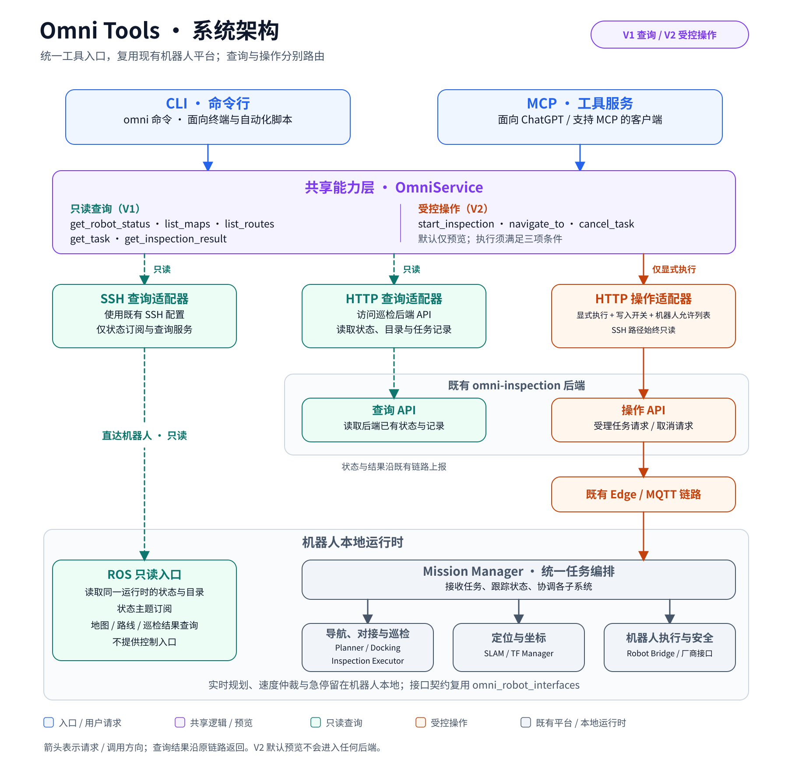
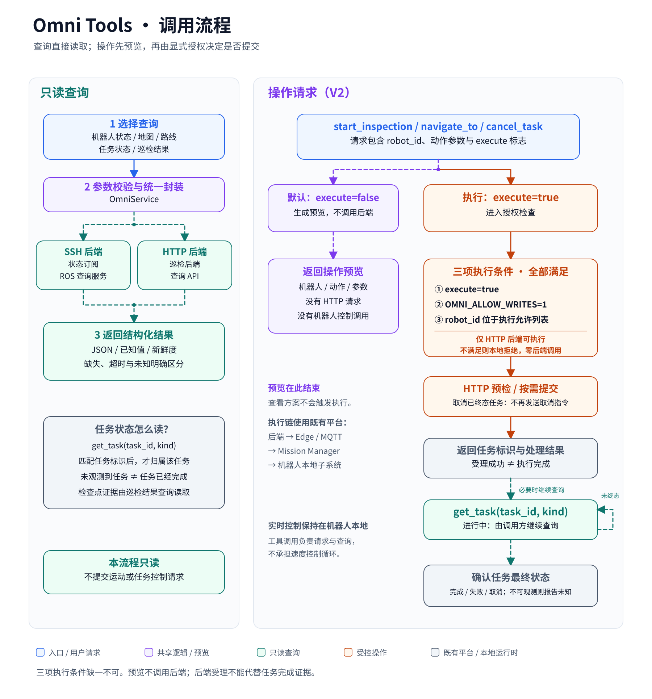

# Omni Tools：机器狗 MCP 与 CLI

统一封装 Omni 巡检机器人的现有接口，供 MCP 客户端、终端和自动化脚本调用。
工程名为 `omni_tools`，安装命令为 `omni` 和 `omni-mcp`。Python 3.10+。

## 当前能力

第一版 [`v0.1.0`](https://github.com/hengzhiyou666/omni_dog_chatgpt_mcp_cli/tree/v0.1.0) 提供下面五项查询，已完成 dog4 只读验证。第二版 `0.2.0` 在此基础上增加默认预览的操作接口。

| MCP 工具 | CLI | 功能 |
|---|---|---|
| `get_robot_status` | `omni robot status dog4 --json` | 状态、电量、运行模式 |
| `list_maps` | `omni maps list --robot dog4 --json` | 地图及版本 |
| `list_routes` | `omni routes list --robot dog4 --json` | 路线与地图关联 |
| `get_inspection_result` | `omni inspection result <任务编号> --robot dog4 --json` | 巡检结果与证据元数据 |
| `get_task` | `omni task status <任务编号> --robot dog4 --json` | 任务状态 |

以上五项工具标记为 MCP `readOnlyHint=true`。以下操作工具标记为 `readOnlyHint=false`，默认 `execute=false`：

| MCP 工具 | CLI | 行为 |
|---|---|---|
| `start_inspection` | `omni inspection start --robot dog4 --route <云路线编号> --json` | 预览巡检启动 |
| `navigate_to` | `omni navigation start --robot dog4 --map <云地图编号> --map-version 1 --x 1 --y 2 --yaw 0 --json` | 预览导航；米、弧度 |
| `cancel_task` | `omni task cancel <任务编号> --robot dog4 --kind inspection --json` | 预览取消任务 |

默认预览只验证参数并返回意图，**没有网络访问，也不验证路线实际存在或目标可达**。`get_task` / `omni task status` 另支持 `kind="navigation"` / `--kind navigation` 查询云导航目标。

## 架构与调用流程





两张图使用相同的职责配色和图例；[图示说明](docs/DIAGRAMS.md) 包含阅读顺序与边界。PNG 预览位于同目录，SVG 可继续编辑。

## 安装

```bash
git clone https://github.com/hengzhiyou666/omni_dog_chatgpt_mcp_cli.git
cd omni_dog_chatgpt_mcp_cli
python3 -m venv .venv
.venv/bin/python -m pip install -e '.[dev]'
.venv/bin/omni --help
```

使用官方 MCP Python SDK 的受维护 1.x 分支（`mcp>=1.30,<2`）；版本边界避免 SDK 2.x 的不兼容升级。

## 连接 dog4：SSH 只读适配器

默认配置是 `OMNI_BACKEND=ssh`、`OMNI_SSH_HOST=dog4`、`OMNI_ROBOT_ID=dog4`。
电脑上须先有可用的 SSH 别名、密钥和可信主机记录；工具采用非交互认证，不接受未知主机或修改 SSH 配置。

```bash
.venv/bin/omni robot status dog4 --json
.venv/bin/omni maps list --robot dog4 --json
.venv/bin/omni routes list --robot dog4 --json
```

只读探针从正在运行的 Mission Manager 进程获取 ROS 环境，短暂订阅状态或调用允许的查询服务；执行结束即退出。
机器人需要已有 Python 3、rclpy、接口消息包和 Mission Manager。无需在机器人上安装本工程或更改 `/userdata/1_heng`。
一个 SSH 配置绑定一个机器人；传入其他机器人编号会被拒绝。可用 `--ssh-host` 或 `OMNI_SSH_HOST` 切换已配置的 SSH 别名。
SSH 通道在第二版中仍保持只读；操作执行只能经 HTTP 后台进入现有 Mission Manager 调度链。

## 连接巡检后台：HTTP 适配器

```bash
export OMNI_BACKEND=http
export OMNI_BASE_URL=https://your-inspection-server.example
export OMNI_TOKEN='从巡检后台取得的令牌'
export OMNI_ROBOT_ID='后台中的机器人编号'
.venv/bin/omni robot status --json
```

`OMNI_BASE_URL` 支持站点地址、路径前缀或以 `/api/v1` 结束的地址。远端要求 HTTPS；本机测试可用 HTTP。
令牌只通过环境传入，不放在命令参数、仓库或日志里。适配器不跟随重定向。
全局选项放在子命令之前，例如 `omni --backend http --timeout 20 maps list --json`。

## MCP 接入

本地 MCP 客户端配置进程命令为本仓库的绝对路径 `.venv/bin/omni-mcp`，参数 `--transport stdio`，环境变量与 CLI 相同。
可参考 [stdio 配置示例](examples/mcp-stdio.json)，其中 `mcpServers` 格式需按具体客户端调整。

```bash
.venv/bin/omni-mcp --transport stdio
# 另一种传输：本机 Streamable HTTP，地址 http://127.0.0.1:8766/mcp
.venv/bin/omni-mcp --transport streamable-http --port 8766
```

HTTP 入口仅监听本机，没有内置公网登录服务。远程 ChatGPT 接入还需要受支持的账户入口、可访问的 HTTPS 地址和认证网关（例如 OAuth）；这些部署配置不在本次自动安装范围内。不能将本机地址直接填成 ChatGPT 可访问的公网服务。
所有 MCP 工具返回结构化 JSON；业务错误使用 `isError=true`，标准输出仅用于 MCP 协议。

## 第二版操作与默认保护

真实执行同时需要以下条件：HTTP 后台已配置、`OMNI_ALLOW_WRITES=1`、目标机器人列在 `OMNI_ALLOWED_ROBOTS`，以及本次调用明确传入 `execute=true`（CLI 为 `--execute`）。任一条件缺失都不会发送写请求。配置值不能通过 MCP 工具参数更改。

本次交付保持 `OMNI_ALLOW_WRITES=0`，没有对 dog4 执行任何操作接口。仅以下示例配置展示将来经操作人员授权后如何设置；它不是当前运行配置：

```bash
export OMNI_BACKEND=http
export OMNI_BASE_URL=https://your-inspection-server.example
export OMNI_TOKEN='自己的后台令牌'
export OMNI_ROBOT_ID='已授权的云端机器人编号'
export OMNI_ALLOWED_ROBOTS='已授权的云端机器人编号'
export OMNI_ALLOW_WRITES=0  # 本次交付保持禁用
```

- 巡检：使用既有云路线，先创建任务，再请求启动；响应中的 `task_id` 用于后续查询。
- 导航：明确云地图编号与版本，先创建导航计划；核对地图、目标、可执行状态与过期时间后，才提交导航目标。真实规划在机器人端完成，云端计划不是可行路径的证明。
- 取消：巡检调用 cancel 接口，导航取消目标；不会删除巡检记录。取消请求被接受也不代表机器人已经停止。
- 写请求不自动重试。两阶段中途失败会返回已知任务或计划编号，以及恢复查询信息；超时可能意味着结果尚未确认，不能直接重复创建任务。
- 工具不提供速度、姿态、急停解除或控制权强占接口。实时控制继续由机器人已有系统负责。

操作接口的成功链路、失败链路、超时和取消仅在离线模拟中验证；尚未完成实体巡检、实体导航或真实 HTTP 后台端到端验收。

## 数据与任务语义

- 所有成功结果含 `ok/backend/robot_id/observed_at/data`。`observed_at` 是本次查询时间，不保证后台缓存中的数据刚刚更新；请同时检查源状态时间、有效性和观测信息。
- 电量 `NaN` 等非有限数值转换为 JSON `null`，不能解释成 0% 或正常。
- SSH 使用机器人原生地图、路线和任务编号；HTTP 使用云端编号。云任务对应 ROS mission ID 通常为 `cloud-<task_id>`，工具不会擅自转换。
- SSH `get_task` 只能观察当前发布的任务/操作状态；历史任务未观测到不表示不存在或已完成。历史检查点可通过 `get_inspection_result` 查询，但空结果也不能证明任务成功。
- HTTP 路线按机器人云地图绑定过滤，不代表路线已在机器人上验证可执行。
- ROS 地图/路线提供方可能在上游失败时返回空列表，工具会保留这一限制提示。
- CLI 成功查询或生成预览的退出码为 0；配置、参数、连接、上游业务错误为 2；手动中断为 130。`executed=true` 只表示执行请求已发送并取得接口响应，不表示任务已经完成。

## 验证

```bash
.venv/bin/python -m pytest -q
.venv/bin/python -m build
```

默认测试完全离线：HTTP Mock、SSH 子进程 Mock，以及真正的 MCP stdio / Streamable HTTP 客户端协议交互。测试不会连接 dog4。
实体只读查询的记录见 [验证记录](docs/VALIDATION.md)；设计边界见 [架构说明](docs/ARCHITECTURE.md)。

协议实现参考 [官方 MCP Python SDK](https://github.com/modelcontextprotocol/python-sdk/tree/v1.x)。
