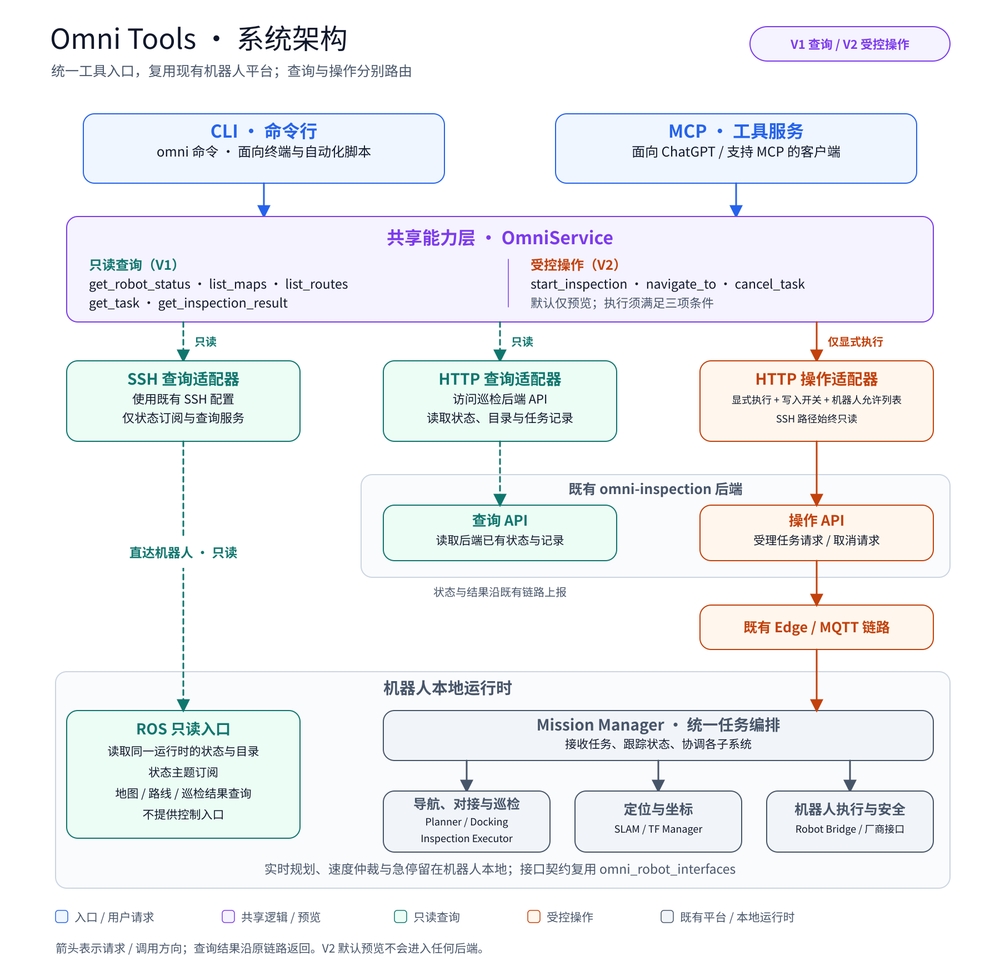
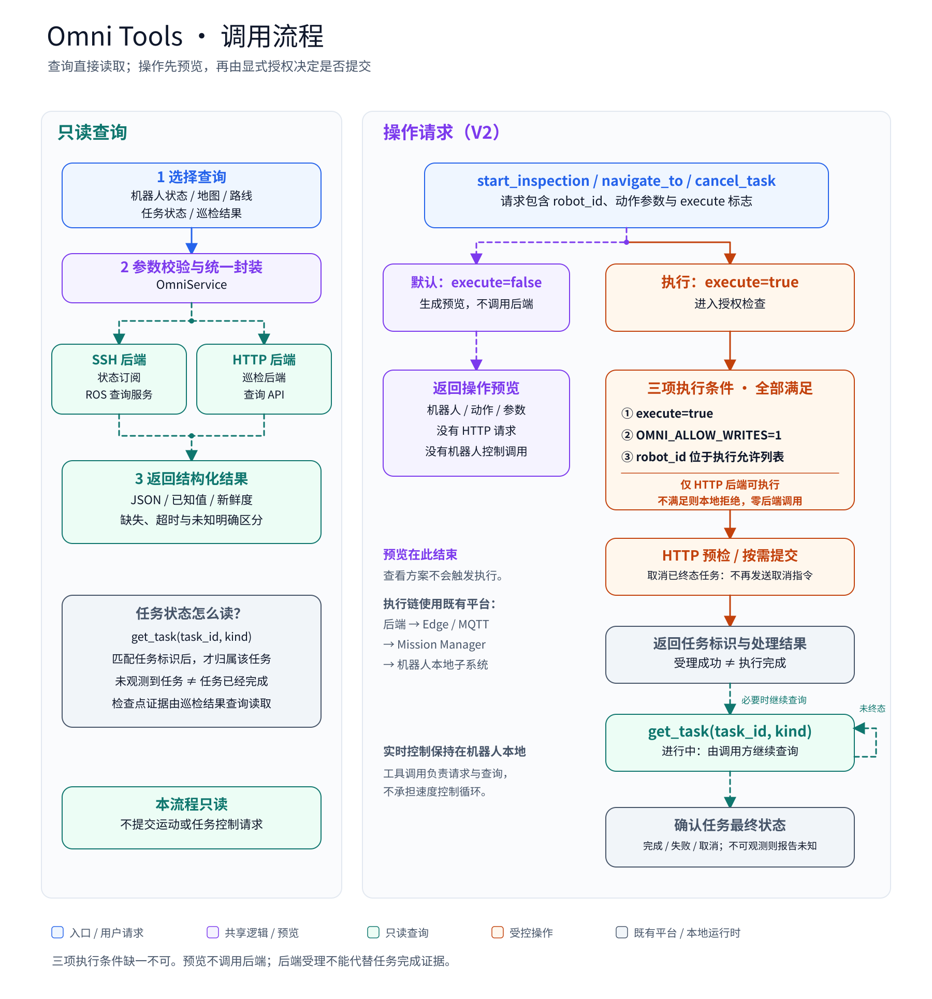

# 架构与调用流程图

这两张图说明 `omni_tools` 如何复用现有系统，以及一次查询或操作请求会经过哪些步骤。SVG 保留可编辑的文字、形状和连线；PNG 适合预览与分享。

| 图 | 可编辑版本 | 图片版本 | 阅读重点 |
|---|---|---|---|
| 系统架构 | [architecture.svg](architecture.svg) | [architecture.png](architecture.png) | CLI 与 MCP 共用能力层，查询和操作分别路由 |
| 调用流程 | [control-flow.svg](control-flow.svg) | [control-flow.png](control-flow.png) | 查询直接读取，操作默认预览，显式执行必须满足授权条件 |

## 系统架构



CLI 与 MCP 都调用 `OmniService`。V1 查询可以通过 SSH 读取机器人 ROS 状态及查询服务，也可以通过 HTTP 读取 `omni-inspection` 后端的状态和任务记录。SSH 查询只允许状态订阅与地图、路线、巡检结果三类查询服务。

V2 的 `start_inspection`、`navigate_to` 和 `cancel_task` 默认只返回预览。只有请求显式指定 `execute=true`、配置启用 `OMNI_ALLOW_WRITES=1`、目标机器人在执行允许列表中，并使用 HTTP 后端时，才允许进入执行路径。SSH 后端保持只读。

执行路径复用现有后端及 Edge/MQTT 链路，由 Mission Manager 与机器人本地子系统处理任务。图中的 Planner、Docking、SLAM、TF Manager 和 Robot Bridge 是既有运行时组成部分，并非 MCP 直接控制的独立工具。每个动作实际需要哪些子系统，取决于任务与当前运行状态；图不表示每次操作都启动所有模块。

HTTP 查询读取的是后端提供的记录；图中没有假定每次 HTTP 查询都会即时访问机器人。查询结果沿原调用链路返回，机器人状态上报复用既有链路。

## 调用流程



左侧展示只读查询：参数校验、选择 SSH 或 HTTP 查询后端，再返回结构化结果。可用值、缺失数据、超时和无法确认的状态应明确区分，不能把空结果或未观测到任务解释成任务成功。

右侧展示操作请求：默认预览在本地结束，不调用后端。显式执行先通过三项授权条件，再由 HTTP 后端进行必要检查及提交；取消一个已处于终态的任务时，可以直接返回已有状态，不再发送取消指令。

后端受理请求与机器人完成任务是不同阶段。需要继续跟踪时，由调用方使用返回的任务标识及任务类型调用 `get_task(task_id, kind)`：巡检任务使用 `kind="inspection"`，单点导航使用 `kind="navigation"`。这两类标识和查询路径不能混用。仍在执行则继续查询；已有可信终态时无需继续轮询，不可观测时应报告未知。工具调用承担任务请求和结果查询，实时速度控制、仲裁与急停继续在机器人本地运行。

## 两张图共用的颜色含义

| 颜色 | 主色 | 含义 |
|---|---|---|
| 蓝色 | `#2563EB` | CLI、MCP 入口与用户请求 |
| 紫色 | `#7C3AED` | 共享逻辑、授权前预览与默认分支 |
| 青绿色 | `#0F766E` | 只读查询、状态读取与结果轮询 |
| 橙色 | `#C2410C` | 受控操作、执行授权与任务提交路径 |
| 灰蓝色 | `#475569` | 既有平台、机器人本地运行时与状态说明 |

连线颜色沿用节点语义。青绿色虚线表示查询，紫色虚线表示预览分支，橙色实线表示经授权的执行路径；箭头表示请求或调用方向。浅色背景用于分组，不引入额外状态含义。颜色说明组件在图中强调的职责或路径，不表示组件只能提供这一类能力；例如 Edge/MQTT 的橙色节点突出任务下发链路，既有链路也承担状态与结果上报。

## 与既有工程的关系

| 工程 | 在接入方案中的位置 |
|---|---|
| `omni-inspection` | 既有 HTTP 后端、任务记录及机器人接入链路 |
| `omni_deck` | 既有移动端界面；与新的 CLI/MCP 入口并存 |
| `omni_mission_manager` | 机器人端统一任务编排与权威任务状态 |
| `omni_planner`、`omni_docking` | 规划、导航与对接相关运行时 |
| `omni_navi` | 版本与部署集成，不是独立的运行时规划器 |
| `omni_slam`、`omni_tf_manager` | 建图、定位与坐标关系 |
| `omni_robot_bridge` | 机器人接口、速度仲裁与本地安全边界 |
| `omni_robot_interfaces` | 各模块复用的消息、服务与动作契约 |

当前实机验证范围为 V1 只读查询；V2 操作执行路径通过离线测试验证，未在实机上发送运动或任务控制命令。图示描述接口与调用边界，不表示已完成实机运动验收。

## 编辑与导出

两张 SVG 使用 `Noto Sans CJK SC` 中文字体、白色背景和矢量文字；可用 Inkscape 等 SVG 编辑器修改。保存后可重新生成对应 PNG：

```bash
inkscape docs/architecture.svg --export-type=png --export-filename=docs/architecture.png
inkscape docs/control-flow.svg --export-type=png --export-filename=docs/control-flow.png
```

画布尺寸分别为 1800 × 1760 和 1800 × 1930 像素。建议保留 SVG 作为编辑源文件，避免从 PNG 重新描画。
